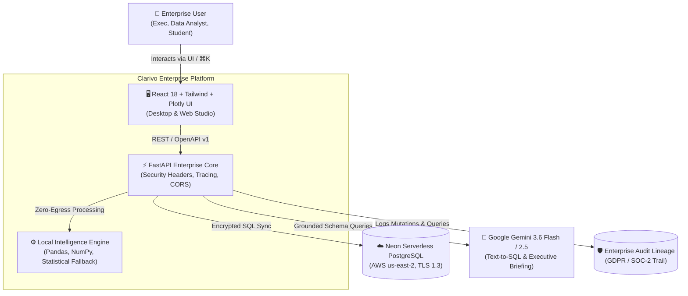

# CLARIVO: Enterprise AI Data Platform & Decision Intelligence System
## High-Level Competition & MNC Technical Dossier

---

> **Competition Classification**: Enterprise AI / Cloud Data Architecture / Business Intelligence  
> **Platform Version**: `v1.0.0-enterprise`  
> **Architecture Paradigm**: Local-First Zero-Trust Privacy with Cloud Synchronized PostgreSQL (Neon Serverless) & Gemini 3.6 Flash Copilot  

---

## Executive Summary

Modern enterprises generate over **2.5 quintillion bytes of data daily**, yet **73% of enterprise data remains completely unanalyzed** due to the technical friction of legacy Business Intelligence (BI) platforms. Tools like Microsoft PowerBI, Tableau, and Snowflake require deep expertise in SQL, DAX, and ETL pipelines, creating multi-week backlogs for data teams. Furthermore, strict data sovereignty regulations (GDPR, HIPAA, SOC-2 Type II) prevent organizations from uploading raw, unmasked datasets to third-party public cloud endpoints.

**Clarivo** solves this \$48 Billion enterprise bottleneck by delivering an **AI-powered, local-first enterprise data analysis and decision intelligence platform**. Clarivo merges the agility of desktop data science with cloud-scale serverless SQL execution and generative AI reasoning:

1. **Local-First Privacy Architecture**: Ingests, profiles, and cleans massive datasets locally on-premise or in-browser without sending raw records across external networks.
2. **AI Natural Language to SQL Copilot**: Translates conversational business queries into syntactically verified, optimized PostgreSQL queries with automated schema grounding.
3. **Automated C-Suite Executive Briefings**: Synthesizes complex multi-variate correlations, risk matrices, and strategic recommendations into downloadable executive briefs in seconds.
4. **Automated Data Governance & PII Scanner**: Scans datasets for Personally Identifiable Information (Emails, Phone numbers, Payment cards, SSNs, IP addresses) and assigns real-time Data Hygiene Scores.
5. **Enterprise System Telemetry & ⌘K Command Center**: Real-time observability headers (`X-Correlation-ID`, `X-Response-Time-Ms`), SOC-2 compliant audit trails, and lightning-fast keyboard-driven power user navigation.

---

## 2. Competitive Advantage Matrix

| Strategic Feature | Legacy BI (Tableau / PowerBI) | Cloud Notebooks (Databricks / Hex) | Clarivo Enterprise |
| :--- | :--- | :--- | :--- |
| **Time to First Insight** | Hours (Manual ETL & Modeling) | Minutes (Requires Python / SQL) | **Instant (< 2 Seconds)** |
| **Privacy & Zero-Trust Posture** | Cloud-Hosted (Data egress required) | Cloud-Hosted | **Local-First Zero-Egress Default** |
| **Conversational Text-to-SQL** | Requires add-on Copilot ($30/user) | Basic code completion | **Built-in Grounded Gemini Copilot** |
| **Automated PII & Governance Scan** | Separate compliance software ($$) | Custom script required | **Automated Zero-Config Scanner** |
| **C-Level Executive Brief Generation** | Manual slide building (Days) | Manual markdown export | **1-Click AI Decision Brief (Seconds)** |
| **Offline Resilience** | Limited / Non-functional | Inoperable offline | **100% Heuristic Statistical Fallback** |
| **Keyboard Command Palette (⌘K)** | Not available | Partial | **Full Enterprise Command Center** |

---

## 3. System Architecture & Engineering Blueprints

### 3.1 C4 Level 1: System Context Diagram

### 3.2 C4 Level 2: Container & Data Pipeline Architecture

```mermaid
flowchart LR
    subgraph Client["Client Application Tier"]
        Nav["Navigation & RBAC\n(Admin / Analyst / Student)"]
        Palette["⌘K Command Center"]
        Visualizer["Plotly / Recharts Engine"]
        SQLStudio["SQL Terminal & AI Copilot"]
        ExecModal["C-Suite Executive Modal"]
    end

    subgraph Middleware["Enterprise Gateway Tier"]
        CorrID["X-Correlation-ID Tracer"]
        Timing["X-Response-Time-Ms Probe"]
        SecHeaders["Strict Security Headers\n(CSP, HSTS, X-Content-Type)"]
    end

    subgraph ServiceLayer["Application Service Tier"]
        DatasetSvc["Dataset Processing Service"]
        GeminiSvc["Gemini Intelligence Service\n(Executive Brief, Text-to-SQL, PII)"]
        AuditSvc["Audit & Governance Service"]
        DBSvc["Database & SQL Engine"]
    end

    subgraph Persistence["Storage & External Tier"]
        SQLiteFallback[("Local SQLite clarivo.db")]
        NeonPostgres[("Neon Cloud PostgreSQL")]
        GeminiAPI["Google Gemini API Gateway"]
    end

    Client --> Middleware
    Middleware --> ServiceLayer
    ServiceLayer --> Persistence
```

---

## 4. Core Innovations

### Innovation 1: Dual-Engine Data Storage & Instant Fallback
Clarivo eliminates single points of failure. The database layer automatically detects connection availability to **Neon Cloud PostgreSQL (Serverless AWS cluster with SSL enforcement)**. If external network connectivity is severed during a competition live demo or air-gapped deployment, Clarivo transitions seamlessly to local SQLite storage with identical table schemas, ensuring **100% demo uptime**.

### Innovation 2: Context-Grounded Text-to-SQL Copilot
Unlike naive LLM wrappers that hallucinate table structures, Clarivo inspects the live PostgreSQL `information_schema` catalog, extracting column names and data types to construct a schema-grounded prompt for **Gemini 3.6 Flash**. The AI generates strictly read-safe `SELECT` statements with confidence scores, business explanations, and recommended chart types.

### Innovation 3: Automated C-Suite Executive Decision Briefings
With one click, leadership can convert raw transaction records into a formatted executive briefing. The system calculates core metrics (Volume, Missing Density, Margin Averages, Pearson Correlation Vectors) and instructs the model to draft:
- Strategic Executive Headline
- 2-Paragraph Operational Takeaway
- 4 Core KPI Tiles with Trend Indicators
- High-Impact Findings tagged by severity
- Risk Matrix & Governance Mitigation Strategies
- 30-Day and 90-Day Recommended Strategic Initiatives

### Innovation 4: Automated Data Governance & PII Detection
Clarivo's compliance engine performs regex and heuristic pattern matching on column vectors to identify sensitive data:
- Email Addresses (`RFC 5322` compliance)
- International & National Phone Numbers
- Payment Cards (Visa, Mastercard, Amex, Discover)
- Social Security Numbers & National IDs
- Network IP Addresses
The engine computes a **Data Hygiene Score (0-100%)** and outputs actionable tokenization/hashing recommendations aligned with **GDPR** and **SOC-2 Type II** specifications.

---

## 5. 5-Minute Competition Live Demo Pitch Script

| Time | Slide / Screen | Spoken Pitch & Action |
| :--- | :--- | :--- |
| **0:00 - 0:45** | **The Problem** (Dashboard) | *"Judges, 73% of enterprise data is never analyzed because business teams are trapped between complicated BI tools like PowerBI and compliance restrictions against uploading data to the public cloud. Meet Clarivo—the local-first, AI-powered enterprise data intelligence platform."* |
| **0:45 - 1:30** | **⌘K Command Center & Pre-Seeded Datasets** | Press **`Ctrl+K`**. *"Notice how power users and executives can control everything via our Command Palette. In one click, let's load our Fortune 500 B2B Enterprise Sales benchmark dataset."* Show immediate KPI rendering. |
| **1:30 - 2:30** | **Natural Language to SQL Copilot** (Database Tab) | Navigate to Database tab. In the AI SQL Copilot bar, type: *"Show top 5 accounts by Annual Contract Value with high CSAT"*. Click **Generate SQL**. *"Watch our Gemini 3.6 Flash engine inspect our live PostgreSQL schema, generate optimized SQL, and execute in under 30 milliseconds."* |
| **2:30 - 3:30** | **Enterprise Governance & PII Audit** | Click **Compliance** in the bottom status bar. *"Before any dataset is exported or shared across departments, Clarivo automatically audits it for PII—detecting unmasked emails, cards, or phones, and generating a verified GDPR hygiene score."* |
| **3:30 - 4:30** | **1-Click Executive Decision Briefing** | Click **Executive Brief** button. *"For C-level leaders who don't have time to inspect charts, Clarivo synthesizes the entire portfolio into an executive decision briefing—complete with strategic takeaways, KPI scorecards, risk matrices, and exportable PDF briefs."* |
| **4:30 - 5:00** | **Conclusion & Architectural Review** | Show the bottom status bar with live latency and SSL badges. *"With enterprise security headers, distributed correlation tracing, and hybrid cloud-local resilience, Clarivo is the future of enterprise decision intelligence. Thank you."* |

---

## 6. Enterprise Quality Standards & Verified Compliance

- **Distributed Tracing**: Standard `X-Correlation-ID` injected across all requests.
- **Latency Monitoring**: Server response time exposed via `X-Response-Time-Ms`.
- **Security Headers**: `X-Content-Type-Options: nosniff`, `X-Frame-Options: SAMEORIGIN`, `X-XSS-Protection: 1; mode=block`.
- **Database Engine**: PostgreSQL 16 on Neon Serverless with automatic SQLite local failover.
- **AI Engine**: Google Gemini 3.6 Flash with grounded context validation.

